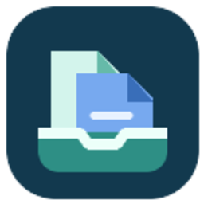
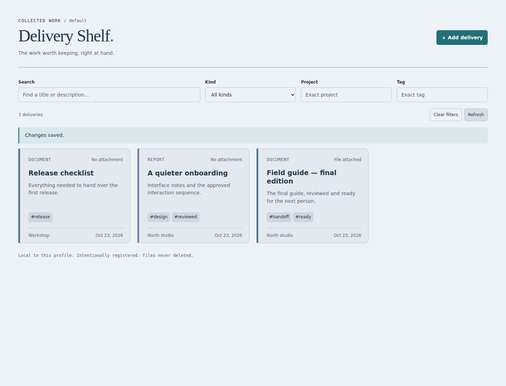
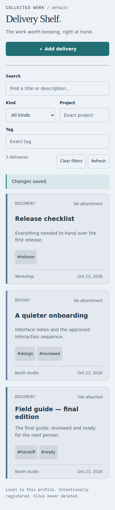

<p align="center"></p>

<h1 align="center">Delivery Shelf</h1>
<p align="center"><strong>Keep the work. Skip the hunt.</strong></p>
<p align="center">A curated home for the reports, images, and other outputs you want to find again—in Hermes Desktop and the web Dashboard.</p>

<p align="center">
  <a href="#quick-start">Quick start</a> ·
  <a href="#what-belongs-on-your-shelf">What it does</a> ·
  <a href="docs/OPERATIONS.md">Setup & troubleshooting</a> ·
  <a href="docs/TECHNICAL.md">Technical guide</a>
</p>


**Your conversations move on. Your finished work shouldn't disappear into them.**

Delivery Shelf gives deliberately saved outputs a title, a project, and a few useful tags. Find a report by what it was for, not by the filename you half remember. Edit its description. Preview a text file. Download an allowed attachment. Remove the card when you no longer need it—without deleting the original file.

No background folder sweeps. No extra model calls. No second cloud account.

## Quick start

Install the plugin in the Hermes environment that owns your files:

```sh
hermes plugins install mechkw/hermes-delivery-shelf --enable
hermes plugins list
```

- **Dashboard:** restart its server if it was already running, refresh, and open **Delivery Shelf**.
- **Desktop:** rescan plugins in **Capabilities → Plugins**, check the Agent and Desktop halves are enabled, and open **Delivery Shelf**.
- **Phone or tablet:** use your existing authenticated web Dashboard. The shelf adapts to the smaller screen; there is no separate mobile app.

Start with a simple request:

> “Add a Delivery Shelf entry called ‘Spring launch report,’ tagged launch and final, under the Website project.”

You can add a metadata-only card immediately. To attach a file, use an approved root alias and a relative path—[see the file setup guide](docs/OPERATIONS.md#attach-a-file).

Using Desktop on a different computer from your Hermes backend? [Install the appropriate halves on both machines](docs/OPERATIONS.md#remote-desktop-setups).

## What belongs on your shelf?

- **The finished report** you will need at the next meeting.
- **The selected image** rather than the entire generation folder.
- **The useful handoff** with enough description to recognize it next week.
- **A project milestone** that deserves a name, a date, and a place to return to.

This is a deliberately curated catalog, not a filesystem browser. Ordinary drafts, temporary screenshots, and every intermediate tool output do not appear unless you choose to register them.

### One collection, two native views



<details>
<summary><strong>Desktop and a phone-sized Dashboard</strong></summary>




The example entries are fictional. Desktop validation scope and host compatibility are recorded in the [technical guide](docs/TECHNICAL.md#compatibility-and-verification).

</details>

## Find it without retracing the conversation

Search titles and descriptions, then narrow the results by tag, kind, or project. Each entry keeps its registration and update dates. Changes use revision checks so an older editor cannot silently overwrite a newer save.

From chat, use:

```text
/shelf launch
```

Or ask Hermes:

> “Find the final reports in my Delivery Shelf for the Website project.”

The plugin's native tools are `delivery_shelf_register` and `delivery_shelf_search`. Editing and removal live in the UI. [Structured examples and API details →](docs/TECHNICAL.md)

## Files stay where they belong

The shelf stores **metadata and a reference**, not another copy of the original file. Optional file access is intentionally narrow:

- Only operator-approved roots and supported file types.
- No hidden paths, traversal, symlinks, or obvious credential/configuration filenames.
- Plain-text previews for text, Markdown, and CSV; Markdown is shown as text, not executed HTML.
- Downloads capped at 10 MiB.
- Removing an entry removes its metadata, **never the source file**.

A moved or deleted file may make its attachment unavailable. The card can still be edited or removed. This is a catalog, not a backup service.

## Privacy, without a mystery tour

- **Profile-local:** each backend profile has its own catalog.
- **Explicit:** no automatic transcript capture or folder scanning.
- **Host-authenticated:** the UI uses Hermes's existing authentication and backend routes.
- **No plugin telemetry:** no analytics service, remote index, or model calls.
- **Persistent:** plugin data survives ordinary updates and uninstall; removing the package is not data erasure.

“Local” means local to your Hermes backend, which can be a remote server. Other software running under the same OS account is not sandboxed by this plugin. [Storage, retention, backup, and removal →](docs/OPERATIONS.md#storage-and-retention)

## Built to fit Hermes

Delivery Shelf is an independent community plugin, not a core fork. It contributes its own page and tools without replacing your chat or changing normal replies. Dashboard and Desktop get their own native adapters, backed by the same small catalog service.

For us, Hermes is the best platform for turning agent work into something useful beyond a single chat. Delivery Shelf gives that work somewhere to land.

## Go deeper

- [Setup, approved file roots, remote hosts, and troubleshooting](docs/OPERATIONS.md)
- [API, storage, security boundaries, architecture, and verification](docs/TECHNICAL.md)
- [Contributing](CONTRIBUTING.md) · [Security](SECURITY.md) · [Changelog](CHANGELOG.md)
- Companion project: [Conversation Bookmarks](https://github.com/mechkw/hermes-conversation-bookmarks)—for the part of the conversation you want to keep.

MIT licensed. Created by [Ken Watts](https://github.com/mechkw).
