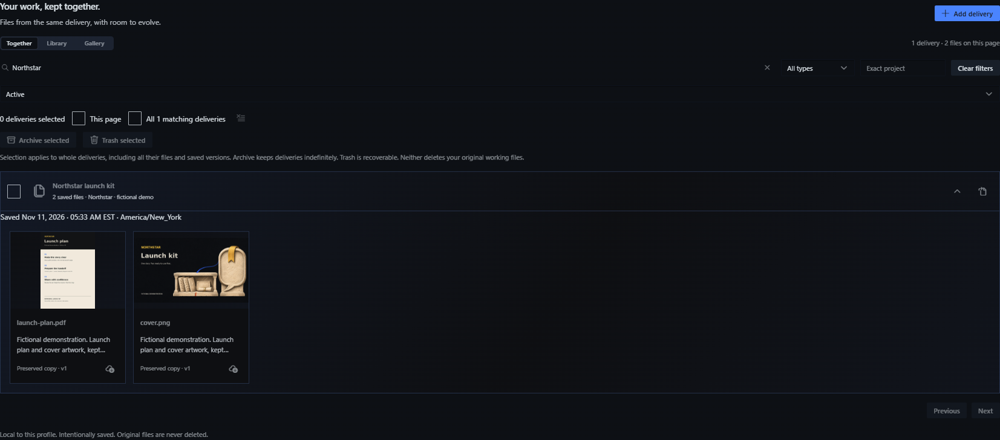
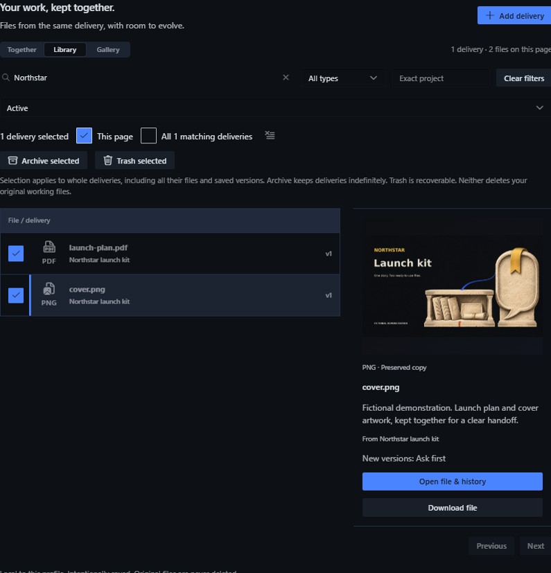

# Delivery Shelf

**Keep the work. Skip the hunt.**

Contest candidate. [Verified workflows and known issues](docs/RELEASE_STATUS.md).

Save the files Hermes delivers, keep related files together, and return to the version you meant. Delivery Shelf gives finished work a home outside the chat scroll.

[Install](docs/INSTALLATION.md) · [Usage guide](docs/USAGE.md) · [Commands](docs/COMMANDS.md) · [Security](SECURITY.md)


<picture>
  <source media="(prefers-color-scheme: dark)" srcset="docs/assets/mark-on-dark.png">
  
</picture>

## Keep the handoff, not the whole folder

A report and its charts belong together. So do a presentation and its supporting spreadsheet. Save that handoff as one **delivery**, with a useful title, description, tags, and project.

Delivery Shelf preserves copies of attached files. When you deliberately save another version, the earlier files remain available. Renaming or removing an original does not remove an already-preserved copy.

Use it for:

- A client handoff with several related files.
- A report you need to retrieve next week without remembering its filename.
- An image you chose to keep, rather than every image generated along the way.
- A revised deliverable whose previous edition still matters.

Nothing joins the Shelf just because Hermes created it. The first save is your choice.

## Install

### Native Hermes Desktop

Open **Capabilities → Plugins → Install from Git** and enter:

```text
https://github.com/mechkw/hermes-delivery-shelf
```

Choose the intended backend and profile, review installation permissions, and enable both the **Agent** and **Desktop** halves. Open **Saved → Deliverables**.

### Backend or web Dashboard

Run on the backend that owns your Hermes profile:

```sh
hermes plugins install mechkw/hermes-delivery-shelf --enable
hermes plugins list
```

Use the installer's activation result to check whether anything still needs a reload. The native Desktop UI is a separate client component; a backend-only install does not install that UI on another computer.

[Full installation guide](docs/INSTALLATION.md), including remote backends and the distinction between native Desktop, browser-hosted Desktop, and the web Dashboard.

## Save your first delivery

After Hermes delivers files in the current conversation, enter:

```text
/shelf add
```

This saves the latest recognized delivery set. If that handoff contains several files, they stay together. To save only the newest file instead:

```text
/shelf add r1
```

Missing title, description, and tags use your configured model when metadata generation is enabled. Supplied details take precedence. Wait for the saved confirmation. If confirmation fails, inspect **Saved → Deliverables** before retrying; the save may already have completed. See [save-confirmation troubleshooting](docs/INSTALLATION.md#check-a-save-after-an-interrupted-confirmation).

Prefer to choose first? In native Desktop, use the **Plus → Delivery Shelf** entry or **Saved → Deliverables → Add delivery**. Choose a conversation, select delivered files, enter details or generate a draft, then select **Save**. Generating a draft does not save it.

## Browse the way the work makes sense

Native Desktop has three browsing views:

| View | Best for |
| --- | --- |
| **Together** | Browse grouped deliveries and their companion files. |
| **Library** | Scan a compact file list with an adjacent inspector. |
| **Gallery** | Recognize files by thumbnail or file-type icon. |

Previewing a file and selecting a delivery are separate actions. Checkboxes select the **whole delivery**, including its files and saved versions, for cleanup.

Open a delivery to inspect its files, switch versions, download a preserved copy, edit metadata, or add a version. Source details retain the original path and conversation association where that provenance is available.



*Together view in the installed native app. Northstar is fictional demonstration content.*



*The checkboxes select one delivery and both companion files. The inspector previews cover.png independently.*

## Keep revisions without making every save automatic

Use **Add version** when you want to save a new edition of an existing delivery. A version is a preserved set of files, not a link to whatever happens to occupy the original paths later.

Hermes can also offer a concrete new version of a delivery you already saved. You can approve that version, keep the current one, or choose **Always for this delivery**. That permission applies to the named saved delivery only. It never authorizes first saves or a global folder watcher.

The delivery's details show **Ask first**, **Always for this delivery**, or a paused state. Use **Ask before next version** to revoke standing approval. Automatic version updates pause outside Active.

## Clear space without deleting your originals

- **Archive** keeps deliveries indefinitely and out of the active collection.
- **Trash** keeps deliveries recoverable for the configured 30 or 60 days.
- **Empty Trash** starts a separate 60-minute recovery window in **Pending deletion**.

After the recovery deadline, cleanup can permanently delete Shelf's preserved copies and versions. Original working files are never the cleanup target. Changing retention also changes deadlines for items already in Trash.

Native plugin settings include browsing defaults, date and timezone display, metadata generation, cleanup, and storage usage. [Manage deliveries and recovery](docs/USAGE.md#manage-deliveries-and-recovery).

## Find or retrieve work from chat

```text
/shelf
/shelf search launch
/shelf help
```

Bare `/shelf` browses; `/shelf add` saves. On configured Telegram connections, the native panel includes delivery actions and file sending. `/shelf r3` retrieves the primary attachment from the **third** most recently saved delivery, not three deliveries. File retrieval does not call a model.

[Command reference](docs/COMMANDS.md) covers recent-file selectors, advanced explicit-file saves, Telegram setup, and source limits.

## Privacy and file boundaries

The catalog and preserved files live in the selected Hermes **backend profile**. A remote backend means the data is on that server, not necessarily on your laptop.

- No automatic first capture, background folder scan, plugin analytics service, or remote Shelf index.
- Only approved roots and supported file types can be attached. Individual files are limited to 10 MiB.
- Explicit metadata generation sends bounded selected-file content and conversation context through Hermes's configured provider. Browse and download do not need that model call.
- Older **Original-file link** entries still need their sources. A **Preserved copy** is stored by Shelf.

Shelf preserves selected deliverables; it is not a transcript backup, filesystem backup, or encrypted vault. [Storage, generation, and privacy details](docs/USAGE.md#storage-and-privacy).

## Better together, still independent

[Conversation Bookmarks](https://github.com/mechkw/hermes-conversation-bookmarks) keeps the conversation or response reference behind a useful decision. Delivery Shelf keeps the resulting files. Install either alone, or use both under **Saved** with separate **Deliverables** and **Bookmarks** tabs.

## Help and project links

- [Usage guide](docs/USAGE.md) and [command reference](docs/COMMANDS.md).
- [Installation and troubleshooting](docs/INSTALLATION.md).
- [Technical reference](docs/TECHNICAL.md), [changelog](CHANGELOG.md), and [contributing](CONTRIBUTING.md).
- [Report a bug](https://github.com/mechkw/hermes-delivery-shelf/issues). Remove private titles, paths, and conversation text from reports.
- Report vulnerabilities privately using the channel in [SECURITY.md](SECURITY.md). If GitHub private reporting is unavailable, email **repobugs@virtuedev.com**. Do not post a vulnerability publicly.

An independent community plugin for [Hermes Agent](https://hermes-agent.nousresearch.com/docs/). [MIT license](LICENSE).
