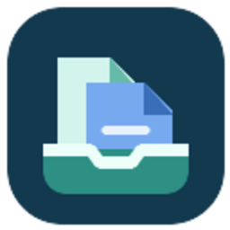
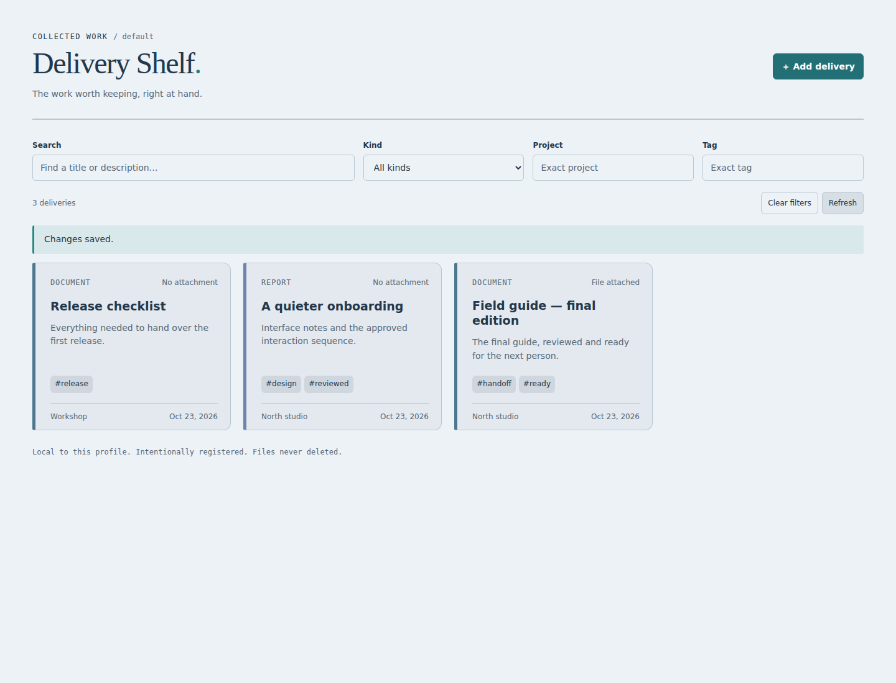
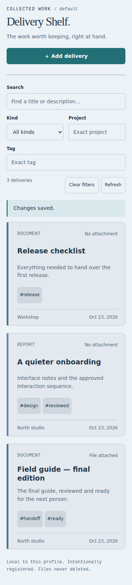

<p align="center"></p>

<h1 align="center">Delivery Shelf</h1>
<p align="center"><strong>Keep the work. Skip the hunt.</strong></p>
<p align="center">A curated home for the reports, images, and other outputs you want to find again—in Hermes Desktop and the web Dashboard.</p>

<p align="center">
  <a href="#quick-start">Quick start</a> ·
  <a href="#what-belongs-on-your-shelf">What it does</a> ·
  <a href="docs/OPERATIONS.md">Setup & troubleshooting</a> ·
  <a href="docs/TECHNICAL.md">Technical guide</a>
</p>


**Your conversations move on. Your finished work shouldn't disappear into them.**

Delivery Shelf gives deliberately saved outputs a title, a project, and a few useful tags. Find a report by what it was for, not by the filename you half remember. Edit its description. Preview a text file. Download an allowed attachment. Remove the card when you no longer need it—without deleting the original file.

No background folder sweeps. No second cloud account. Your existing Hermes agent can fill in the details when you save.

## Quick start

### Native Hermes Desktop

In the installed app, open **Capabilities → Plugins → Install from Git** and enter:

```text
https://github.com/mechkw/hermes-delivery-shelf
```

Select the intended backend/profile, review the normal installation consent, and
verify that **both Agent and Desktop are enabled**. Open **Saved → Deliverables**.
The Desktop UI lives on the app computer; the Agent half and data live on the
selected backend. A server-only install followed by Rescan is not enough for a
remote client. [Existing backend or “unavailable (remote backend)”? →](docs/OPERATIONS.md#remote-desktop-setups)

### Web Dashboard or backend-only installation

Run on the backend that owns your data:

```sh
hermes plugins install mechkw/hermes-delivery-shelf --enable
hermes plugins list
```

Refresh the authenticated **Dashboard** after its plugin routes are loaded; if
needed, restart only that Dashboard server. Open **Saved → Deliverables**. The
Dashboard also adapts to phones and tablets; no separate mobile app is required.

**Browser-hosted Desktop is a different host from the web Dashboard.** The
currently inspected Hermes browser bridge does not load these external Desktop
plugins. Use native Desktop or the Dashboard for the Saved panel; backend tools
can still work without that panel.

Start with a simple request:

> “Add a Delivery Shelf entry called ‘Spring launch report,’ tagged launch and final, under the Website project.”

In **Saved → Deliverables → Add delivery**, choose a conversation, then one of its delivered files. Optionally **Generate details**, review the title/description/tags, and explicitly save. Desktop shows artifact-style thumbnail cards; Dashboard keeps its existing collection view. [File selection, supported content and generation limits →](docs/DESKTOP_FILES.md)

Metadata-only and legacy manual entries remain available under **More options**. Advanced explicit attachments still use an approved root alias and relative path—[see the file setup guide](docs/OPERATIONS.md#attach-a-file).

Using Desktop on a different computer from your Hermes backend? [Install the appropriate halves on both machines](docs/OPERATIONS.md#remote-desktop-setups).

## What belongs on your shelf?

- **The finished report** you will need at the next meeting.
- **The selected image** rather than the entire generation folder.
- **The useful handoff** with enough description to recognize it next week.
- **A project milestone** that deserves a name, a date, and a place to return to.

This is a deliberately curated catalog, not a filesystem browser. Ordinary drafts, temporary screenshots, and every intermediate tool output do not appear unless you choose to register them.

### One collection, two native views


<details>
<summary><strong>Desktop and a phone-sized Dashboard</strong></summary>





The example entries are fictional. Desktop validation scope and host compatibility are recorded in the [technical guide](docs/TECHNICAL.md#compatibility-and-verification).

</details>

## Find it without retracing the conversation

Search titles and descriptions, then narrow the results by tag, kind, or project. Each entry keeps its registration and update dates. Changes use revision checks so an older editor cannot silently overwrite a newer save.

From chat, use:

```text
/shelf launch
/shelf add --file workspaces:launch/report.pdf
/shelf add Spring launch report #launch, final --description "Approved launch summary." --file workspaces:launch/report.pdf
```

`/shelf <query>` searches. On configured Telegram connections, bare `/shelf` opens
an attached inline panel: **Add**, recent entries, then **Browse more**.
On Telegram, `/shelf add` saves a recent file from this conversation **without a
model call**, in private chats and groups/topics. One file saves immediately;
several files open a chooser. An already-saved file keeps its existing card and
metadata. The filename supplies the default title; tags and description stay empty
unless you provide them. If no recent file is available, ask Hermes to save it in
normal chat. Add recognizes explicit `MEDIA:` file references in the active part
of this conversation, not older compressed history or arbitrary links.
[Telegram owner policy, source limits, and derivative offers →](docs/TELEGRAM.md)

Use the advanced `--file` command to choose an exact existing file instead. In that
workflow, your current Hermes agent fills omitted title, tags or description and
verifies the save; fully supplied metadata saves directly. Anything you supply takes precedence. Tags keep their first spelling/case, with boundary
whitespace trimmed and case-insensitive duplicates removed. Tag filtering remains
case-insensitive. There is no metadata questionnaire.

Tags are comma-separated after `#`; use `--description "text"` to set the description.
Quote file references containing spaces. Supplying all details saves directly without
a model turn. Agent-assisted chat commands need Hermes’s [one-time handoff permission](docs/OPERATIONS.md#enable-agent-assisted-metadata).
Use `/shelf search add` to search for the word “add.”

Or ask Hermes:

> “Find the final reports in my Delivery Shelf for the Website project.”

Want a correction? Ask Hermes to change the saved title, tags or description; it updates the existing entry rather than making another card. Native tools are `delivery_shelf_register`, `delivery_shelf_search`, `delivery_shelf_update`, and `delivery_shelf_offer_update`. The last offers a new derivative for approval; same-file edits stay silent. Removal remains in the UI. [Structured examples and API details →](docs/TECHNICAL.md)

### Retrieve a file in Telegram

Open `/shelf`, select an entry, and tap **Send file**. Or use `/shelf dl 1`
(`/shelf download 1`) for item 1 of your last numbered list, valid for ten minutes.
`/shelf search <query>` narrows that list. `/shelf r3` sends up to three recent
attached deliveries; `r1` through `r5` are supported. Missing files are reported,
not replaced with guesses. Retrieval needs **no model call** or agent-handoff consent.
Native transport and the owner policy are required; Desktop/Dashboard remain the
fallback. ZIP files are opaque attachments, never unpacked or previewed.

## Files stay where they belong

The shelf stores **metadata and a reference**, not another copy of the original file. Optional file access is intentionally narrow:

- Only operator-approved roots and supported file types.
- No hidden paths, traversal, symlinks, or obvious credential/configuration filenames.
- Plain-text previews for text, Markdown, and CSV; Markdown is shown as text, not executed HTML.
- Downloads capped at 10 MiB.
- Removing an entry removes its metadata, **never the source file**.

A moved or deleted file may make its attachment unavailable. The card can still be edited or removed. This is a catalog, not a backup service.

## Privacy, without a mystery tour

- **Profile-local:** each backend profile has its own catalog.
- **Explicit:** no automatic transcript capture or folder scanning.
- **Host-authenticated:** the UI uses Hermes's existing authentication and backend routes.
- **No plugin telemetry:** no analytics service or remote index. Assisted saves use your existing Hermes agent/provider; the plugin has no separate model client.
- **Persistent:** plugin data survives ordinary updates and uninstall; removing the package is not data erasure.

“Local” means local to your Hermes backend, which can be a remote server. Other software running under the same OS account is not sandboxed by this plugin. [Storage, retention, backup, and removal →](docs/OPERATIONS.md#storage-and-retention)

## Built to fit Hermes

Delivery Shelf is an independent community plugin, not a core fork. It contributes its own page and tools without replacing your chat or changing normal replies. Dashboard and Desktop get their own native adapters, backed by the same small catalog service.

For us, Hermes is the best platform for turning agent work into something useful beyond a single chat. Delivery Shelf gives that work somewhere to land.

## Command discovery

`/shelf help` shows full syntax. Native Telegram menus use the plugin registry,
but menu priority may be needed to survive the host cap. On official Hermes v0.22.5,
global gateway `/help` and `/commands` omit plugin commands entirely; registering
argument hints cannot fix that host gap. [Menu setup, syntax and verified limitations →](docs/COMMANDS.md)

## Go deeper

- [Setup, approved file roots, remote hosts, and troubleshooting](docs/OPERATIONS.md)
- [API, storage, security boundaries, architecture, and verification](docs/TECHNICAL.md)
- [Contributing](CONTRIBUTING.md) · [Security](SECURITY.md) · [Changelog](CHANGELOG.md)
- Companion project: [Conversation Bookmarks](https://github.com/mechkw/hermes-conversation-bookmarks)—for the part of the conversation you want to keep.

MIT licensed. Created by [Ken Watts](https://github.com/mechkw).
